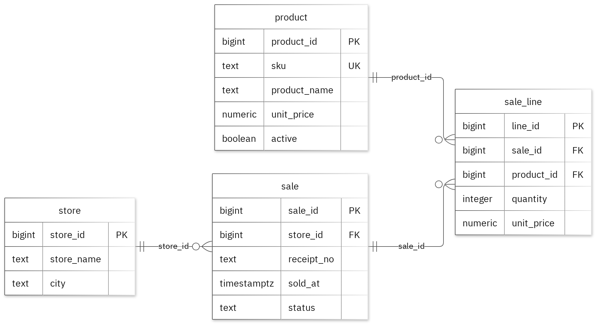

# MIT 8103 Advanced Database Systems

**Retail ERP and POS Management System** · OLUWAFEMI ADEGBOLA · Student ID 301909601

## Case study

The case study is a Retail ERP and POS Management System designed to support three main user groups: cashiers who record point-of-sale transactions, store managers who monitor sales activity, and retail analysts who evaluate product and store performance. The database consists of four core tables: store, product, sale, and sale_line.

The system supports the creation of sales transactions and their associated line items as a single atomic operation. A transaction is committed only when all referenced records exist and all validation rules are satisfied; otherwise, the entire transaction is rolled back to maintain data integrity. Users can retrieve sales records by filtering on transaction date (sold_at) and status, with store information included through table joins. Detailed receipt information is generated by joining sale, sale_line, and product records. The database also supports sales analysis by calculating revenue from the product of quantity and unit_price and aggregating the results by store and product.

For performance evaluation, a separate benchmarking exercise is planned using 50,000 synthetically generated sales records. The benchmark will execute the same sold_at date-range query under two conditions: first without an index and then with a B-tree index. The results will be compared in terms of correctness and observed query execution plans, without presuming that either approach will produce superior performance.

## Portfolio 1: Database Design and Modelling

I organised the relational design into 4 tables - store, product, sale, and sale_line. Primary keys are used to uniquely identify records, while foreign keys maintain relationships between tables and ensure referential integrity. Business rules are enforced through validation constraints, including requirements that sale line quantities must be greater than zero and unit prices must not be negative. The normalisation process is demonstrated through examples progressing from First Normal Form (1NF) to Second Normal Form (2NF) and finally Third Normal Form (3NF). Testing confirmed that all eleven intentionally invalid insert operations were rejected successfully, while the valid sample data remained unchanged.

Figure 1. Tables, keys and relationships. PK: primary key; FK: foreign key; UK: unique value.

<!-- PAGE BREAK -->

## Portfolio 2: Query Processing and Optimisation

I ran three SQL queries against the sample records. The join returned 1 rows and included R-100 with SKU-001. For the index comparison, I used 50,000 separate performance rows. The median lookup time changed from 2.419 ms to 0.283 ms. Both phases returned the same records. The measured plan used the new index. These timings apply to this lookup and environment.

## Portfolio 3: Transactions and Concurrency

I used a temporary counter on sale to test COMMIT, ROLLBACK and READ COMMITTED isolation. The uncommitted update remained hidden from the other session, and ROLLBACK restored the earlier committed value. Without locking, two increments left the counter at 2. With SELECT FOR UPDATE, Session B waited for Session A and the final value was 3. The helper is confined to this exercise; the case's original business fields stay unchanged.

## Portfolio 4: NoSQL and Advanced Data Models

I used pos_events for the case's event documents. MongoDB inserted 2 sample events and returned the expected results for 4 queries. Validation rejected an invalid date type and a duplicate event ID. Embedded snapshots keep related details with an event, while the details field can differ by event type. These are fictional events; PostgreSQL continues to enforce its relational rules.

## Repository and evidence

https://github.com/oadegbola9601/ADEGBOLA_OLUWAFEMI_301909601

The portfolio folders contain the SQL and JavaScript, explanations, query plans, result tables and screenshots.

<!-- PAGE BREAK -->

## Portfolio 5: Distributed and Cloud Database Exercise

I proposed three MongoDB replica members across separate failure zones. The discussion covers primary elections, majority acknowledgement, secondary lag and sharding trade-offs for pos_events. Replication supports availability, while backups address recovery. PostgreSQL needs its own availability plan. This is the permitted discussion option; no live replica set or failover test was deployed.

## Individual reflection

I kept store, product, sale, sale_line in separate tables so their details could be maintained without repeating them in every related record. Each sale line has quantity greater than zero and a nonnegative unit price. The constraint tests check this alongside the required values and record links. One issue illustrated by the two-session exercise is that both sessions can read the same value before either update is committed. Locking the row before reading preserves both increments. The index comparison also shows why I need to check the execution plan as well as the final answer: the same result can require different amounts of database work.

## AI-use declaration

I used GitHub Copilot and the portfolio generator to help prepare the database model, scripts and explanations. The generator ran the PostgreSQL and MongoDB exercises, checked their outputs and captured the result images.  I remain responsible for checking and explaining the submitted work.

## References

- [PostgreSQL: constraints](https://www.postgresql.org/docs/17/ddl-constraints.html)
- [PostgreSQL: EXPLAIN](https://www.postgresql.org/docs/17/using-explain.html)
- [PostgreSQL: isolation](https://www.postgresql.org/docs/17/transaction-iso.html)
- [PostgreSQL: row locks](https://www.postgresql.org/docs/17/explicit-locking.html)
- [MongoDB: data modelling](https://www.mongodb.com/docs/manual/data-modeling/)
- [MongoDB: replication](https://www.mongodb.com/docs/manual/replication/)
- [MongoDB: sharding](https://www.mongodb.com/docs/manual/sharding/)
- [Mermaid: ER diagrams](https://mermaid.js.org/syntax/entityRelationshipDiagram.html)

